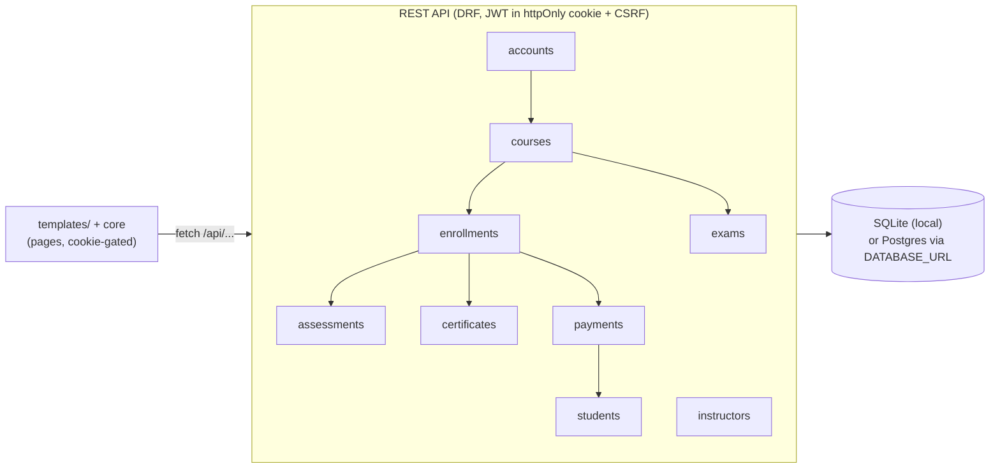

# Skillstudio

A course marketplace built with Django and Django REST Framework. Instructors publish courses with video, text and quiz lessons; students buy them from a wallet, learn lesson by lesson, take timed exams and earn PDF certificates.

The pages are server-rendered Django templates that call the JSON API with `fetch`. There is no separate frontend app. The project runs locally only and is **not deployed** ([Decision D-03](AUDIT_REPORT.md#d-03)).

Known issues and the fix plan are tracked in [AUDIT_REPORT.md](AUDIT_REPORT.md).

## What it does today

**Students**
- Browse and search the catalogue, with filters for category, level, price, duration and instructor.
- Enroll in free courses, or buy paid ones from their wallet. The course page checks coupon codes, and the payment history links to receipts and wallet refund requests.
- Learn in order: each lesson unlocks after the previous one is completed. Video lessons support YouTube and Vimeo URLs.
- Take lesson quizzes. A quiz has an optional time limit (enforced by the server) and a limited number of retakes.
- Take course exams. An exam has a time window, and its questions stay hidden until an attempt starts.
- Download a PDF certificate with a QR verification link once a course is complete.
- Save private notes and bookmarks from lessons, add courses to the wishlist, and manage those items in Saved learning. Use account settings to create and revoke API keys.

**Instructors**
- Create courses, modules and lessons. A course goes through draft → review → published.
- Build quizzes and exams. A quiz stays a draft until it is published.
- See dashboards for enrollments, engagement and revenue, and export a CSV of lesson analytics.
- Receive sale proceeds into their wallet after the platform fee. The Payouts page requests manual bank transfers when payout destination encryption is configured.

**Admins**
- Publish or reject courses that instructors submit for review, and manage users and roles.
- Approve wallet refunds from Refunds and review manual transfers from Payouts. Mark a bank transfer sent after making it outside SkillStudio.

**Not built yet:** wallet top-ups (planned as Stripe *test mode*, [D-01](AUDIT_REPORT.md#d-01)). Until they exist, there is no user-facing way to add funds. The Stripe webhook endpoint returns `503` on purpose.

## Architecture



| App | Owns |
|---|---|
| `accounts` | Custom `User` (roles: student / instructor / admin), profiles, API keys, login and refresh with JWT cookies |
| `core` | Server-rendered pages, cookie login gate, template contract tests, browser smoke tests, `api_routes` command |
| `courses` | Categories, courses, modules, lessons, resources; access policies (`courses/policies.py`); review workflow |
| `enrollments` | Enrollments, lesson progress, the lesson-unlock rule (`lesson_lock_state`), wishlist, course completion |
| `assessments` | Lesson quizzes: attempts, retakes, time limits, answer snapshots, analytics |
| `exams` | Question bank, course exams with time windows, attempts and results |
| `certificates` | Certificate issue, PDF rendering (ReportLab + QR) and public verification |
| `students` | Student profile, notes, bookmarks, dashboard, and the **wallet ledger** (`Wallet`, `WalletTransaction`) |
| `instructors` | Instructor profile, dashboard, students list, featured instructors |
| `payments` | Course purchase from the wallet, platform fee, coupons, refunds, payouts, webhook log, disputes |

Each app has a short README covering its rules and invariants. Every endpoint is listed in **[docs/API_ROUTES.md](docs/API_ROUTES.md)**, which is generated from the URLconf.

The OpenAPI contract is served at `/api/schema/` and checked in as [docs/openapi.yaml](docs/openapi.yaml). Regenerate it after changing the API with `python manage.py spectacular --validate --fail-on-warn --file docs/openapi.yaml`. Pull-request CI validates the generated schema and compares it with the snapshot.

Standalone list responses use `count`, `next`, `previous`, and `results`. Errors include a readable `detail`, a machine-readable `code`, and a `fields` object for validation messages.

### Rules worth knowing before you change code
- **One money path** ([D-01](AUDIT_REPORT.md#d-01)): money enters a wallet (top-up), and a course is bought from the wallet by `payments.services.purchase_course`. Every balance change goes through `Wallet._apply_delta`, which row-locks the wallet and writes a ledger row.
- **Access** is decided in `courses/policies.py`. Lesson order is decided by `enrollments.services.lesson_lock_state`. Use these instead of re-checking enrollment status in views.
- **Signup role comes from the email domain** ([D-02](AUDIT_REPORT.md#d-02)):
  - `@instructor.com` signs up as an instructor.
  - Any other domain signs up as a student.
  - `@admin.com` can't sign up at all. Admins are created by an admin.

## Local setup

Requires Python 3.13.

```bash
python3 -m venv .venv
source .venv/bin/activate                 # Windows: .venv\Scripts\activate
pip install --require-hashes -r requirements.txt

cp .env.example .env                      # then set DEBUG=True for local work
python manage.py migrate
python manage.py create_categories        # seed the course categories
python manage.py createsuperuser          # an admin for /admin/
python manage.py runserver
```

Open http://localhost:8000/. With no `DATABASE_URL`, the app uses `db.sqlite3` in the project folder.

The Tailwind CSS bundle is checked in. After changing utility classes in templates or JavaScript, run `npm ci` and `npm run build:css` and include the regenerated `static/css/app.css`. The build uses the pinned Tailwind CLI and CI verifies that the bundle matches its sources.

**Dependencies.** Direct dependencies live in `requirements.in` and `requirements-dev.in`. The `.txt` files are generated and hash-locked, so don't edit them by hand. To add or upgrade a package:

```bash
pip install pip-tools
pip-compile --generate-hashes --strip-extras --allow-unsafe requirements.in
pip-compile --generate-hashes --strip-extras --allow-unsafe requirements-dev.in
pip-sync requirements.txt requirements-dev.txt   # make your venv match exactly
```

## Admin console

Sign in at `/admin/` with a staff account. The overview shows the platform totals, enrollment activity, work queues and recent console changes your account can access. Each queue leads to searchable records or a decision form.

- Course reviewers can publish a submission, return it to draft with feedback, or archive a published course. Finance operators can approve or reject wallet refunds, approve or reject payout requests, and record a transfer reference after sending a payout externally. The console records the operator and decision in the record’s history.
- Create the initial superuser with `python manage.py createsuperuser`. To delegate, a superuser creates permission groups, creates an account with the **Admin** role, and assigns the appropriate groups on its account page. Grant **view** for monitoring and **change** for decisions on the relevant models, such as Course, Refund or Payout. Grant **view log entry** to let staff see other operators’ recent activity for models they can access.
- Admin accounts created or promoted in the console are console-only by default. This restriction also blocks JWT and API-key authentication. Existing website administrators retain their current access unless a superuser enables **Admin console only** on their account.

## Tests

```bash
pip install --require-hashes -r requirements.txt -r requirements-dev.txt
python -m playwright install chromium     # once, for the browser smoke tests

python manage.py test                     # everything
python manage.py test --exclude-tag browser   # skip the browser tests (faster)
python manage.py test --tag browser           # only the browser tests
```

- Tests use a throwaway SQLite database by default. Set `TEST_DATABASE_URL` to use a local PostgreSQL server. The test runner refuses remote database hosts by default.
- Each run gets a temporary `MEDIA_ROOT`, so certificate PDFs from tests never land in `media/`.
- The browser smoke tests skip themselves when Playwright or Chromium isn't installed.
- CI runs Django checks and the full suite on PostgreSQL with Chromium. The separate dependency audit checks the hash-locked runtime requirements with `pip-audit`.
- `core.tests` also fails in two cases:
  - A model changed without a migration.
  - [docs/API_ROUTES.md](docs/API_ROUTES.md) is out of date. Fix it with `python manage.py api_routes --write`.

Login allows five requests per minute per client IP. Registration and token refresh have their own limits. Enrollment and payment mutations are limited per authenticated user. A throttled request returns HTTP 429 with a `Retry-After` header. Rate counters are held in memory by the local server process and reset on restart.

## Migrations

- **Back up the database before applying migrations to any database you care about.** Several older migrations delete data and can't be reversed: `core/0001`–`0002` drop the removed social-feature tables, and `assessments/0004` and `exams/0003` delete non-MCQ questions. For Postgres: `pg_dump "$DATABASE_URL" > backup.sql`.
- Run `python manage.py migrate --plan` before `migrate`. Read every `Raw Python operation` / `Raw SQL operation` line in the plan before applying it.
- `accounts/0001_squashed_0008` replaces the old `accounts` 0001–0008 for new databases. Databases that already applied the old files keep working. The old files can be deleted once no database still needs them.
- Before applying `payments/0005_encrypt_payout_destination` to a database with payout details, set `PAYOUT_DETAILS_ENCRYPTION_KEY` using the generator in [.env.example](.env.example). Keep the key separate from database backups and retain it for existing encrypted rows. Backups taken before this migration and any rollback to `payments/0004` contain plaintext payout details.

## Secrets and repository hygiene

- `.env` is git-ignored. Only `.env.example`, with placeholders, is committed.
- Payout requests can include `account_details` when a payout encryption key is configured. Responses return `{"provided": true}` for stored details or `{}` for no details. Django admin shows whether the destination is on file. An authorized operator with access to the key can use `Payout.get_account_details()` in a trusted local Django shell for manual processing.
- Install the hooks once per clone: `pip install pre-commit && pre-commit install`. They block:
  - committed secrets (gitleaks)
  - `.env` files
  - virtualenvs and `*.pyc` bytecode
- A GitHub workflow runs the same secret scan on every push.

## Roadmap

The open items in [AUDIT_REPORT.md](AUDIT_REPORT.md) are the roadmap. The main ones:
- Stripe test-mode wallet top-up (SEC-01, PAY-04, PAY-05).
- An OpenAPI schema (API-04).
